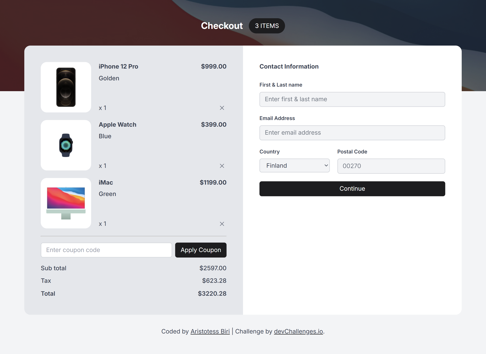

<h1 align="center">dc-apple-shop-checkout | devChallenges</h1>

   Solution for a challenge <a href="https://devchallenges.io/challenge/apple-shop-checkout-page-challenge" target="_blank">Device Shop Checkout</a> from <a href="http://devchallenges.io" target="_blank">devChallenges.io</a>.

  <h3>
    <a href="https://aristotess-biri.github.io/dc-apple-shop-checkout/">
      Solution
    </a>
     | 
    <a href="https://devchallenges.io/challenge/apple-shop-checkout-page-challenge">
      Challenge
    </a>
  </h3>

<!-- TABLE OF CONTENTS -->

## Table of Contents

- [Overview](#overview)
  - [What I learned](#what-i-learned)
  - [Useful resources](#useful-resources)
- [Built with](#built-with)
- [Acknowledgements](#acknowledgements)
- [Contact](#contact)

<!-- OVERVIEW -->

## Overview

### What I learned

This was meant to be a quick simple challenge for me, but it quickly became a learning hub. I had to recap many things I had forgotten or had glimpsed over in the past.

One major example of this would be replaced elements e.g. images and their styling in CSS. This was my first time using the `<picture>` element in HTML. Also dealing with the browser defaults of input elements. Then knowing when best to use grid vs flexbox.

This was a good example of knowing how to do something is vastly different from actually doing it.

### Useful resources

- [HTML standard](https://html.spec.whatwg.org/multipage/embedded-content.html)
- This [article](https://dev.to/stasxreal/open-graph-for-websites-a-complete-guide-gof) on Open Graphs
- Kevin Powell's [Responsive CSS Images](https://www.youtube.com/results?search_query=Kevin+Powell+responsive+CSS+images)

### Built with

- Semantic HTML5 markup
- CSS custom properties
- Flexbox
- CSS Grid

## Acknowledgements

- [W3C HTML validator](https://validator.w3.org/)
- [W3C CSS validator](https://jigsaw.w3.org/css-validator/)
- [CSS Clamp Generator](https://superspeedapp.com/tools/css-clamp-generator)

## Contact

- GitHub [Aristotess-Biri](https://github.com/Aristotess-Biri/)
